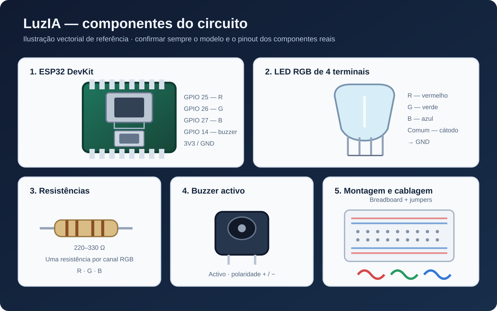

# Componentes da LuzIA

A imagem é uma ilustração vectorial de referência, não uma fotografia nem a representação de um modelo comercial específico.

| Componente | Quantidade | Observações |
|---|---:|---|
| ESP32 DevKit | 1 | ESP32-WROOM-32 ou equivalente; confirmar pinout da placa |
| LED RGB de 4 terminais | 1 | Cátodo comum na configuração padrão |
| Resistências | 3 | 220–330 Ω, uma por canal RGB |
| Buzzer activo | 1 | Opcional; usar transistor NPN como etapa de comutação |
| Transístor NPN | 1 | Dimensionado para a corrente do buzzer |
| Resistência de base | 1 | Valor calculado; 1 kΩ como referência inicial |
| Fonte para buzzer | 1 | Se necessária para a tensão/corrente nominal do componente |
| Breadboard | 1 | Para montagem de protótipo |
| Cabos jumper | Vários | Para sinais, alimentação e massa |
| Cabo USB | 1 | Programação e alimentação da placa |

## Atenção à escolha dos componentes

A designação ESP32 DevKit abrange várias placas com diferenças de disposição dos pinos. O LED RGB também pode ter sequências físicas diferentes de terminais. Confirma sempre as marcações da placa e a folha de dados do LED antes de ligares o circuito.

Para o buzzer, verifica tensão nominal e corrente. A montagem de referência usa um transistor NPN como etapa de comutação, com resistência de base e alimentação adequada. Não ligues o buzzer directamente ao GPIO. Liga todas as massas em comum. Para cargas indutivas, avalia a necessidade de díodo de roda livre conforme a construção do buzzer.
