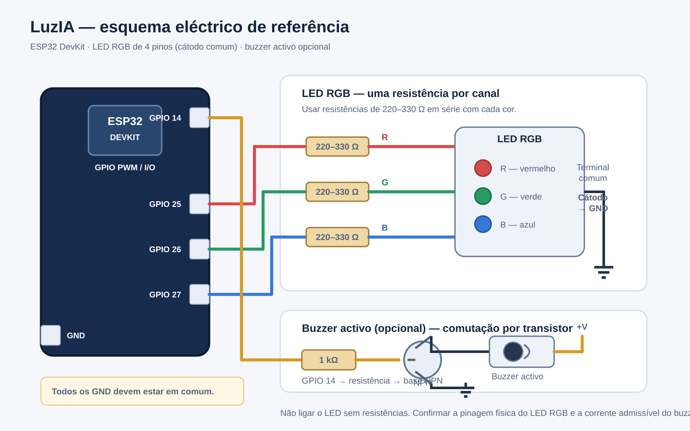

# Esquema eléctrico e lista de componentes

O diagrama corresponde ao firmware actual e à configuração documentada no projecto: LED RGB de quatro pinos, cátodo comum, e buzzer activo opcional.

## Ligações

| Sinal | ESP32 | Ligação |
|---|---:|---|
| Canal vermelho | GPIO 25 | GPIO → resistência 220–330 Ω → terminal R do LED |
| Canal verde | GPIO 26 | GPIO → resistência 220–330 Ω → terminal G do LED |
| Canal azul | GPIO 27 | GPIO → resistência 220–330 Ω → terminal B do LED |
| Comum do LED | GND | Cátodo comum → GND |
| Buzzer (controlo) | GPIO 14 | Base de transistor NPN através de resistência de 1 kΩ; não alimentar o buzzer directamente pelo GPIO |
| Buzzer negativo | GND | Massa comum |

## Lista de material (BOM)

| Quantidade | Componente | Especificação |
|---:|---|---|
| 1 | Placa ESP32 DevKit | ESP32-WROOM-32 ou equivalente |
| 1 | LED RGB | 4 pinos, cátodo comum |
| 3 | Resistência | 220–330 Ω, uma por canal |
| 1 | Buzzer | Activo, tensão nominal conforme datasheet, opcional |\n| 1 | Transístor NPN | Ex.: BC547 ou 2N2222, dimensionado para a corrente do buzzer |\n| 1 | Resistência de base | Cerca de 1 kΩ como ponto de partida; confirmar corrente de base e ganho |
| 1 | Breadboard | Compatível com a placa |
| Vários | Cabos jumper | Macho-macho conforme a montagem |
| 1 | Cabo USB | Dados e alimentação da placa |

## Notas de segurança eléctrica

- O esquema é para LED RGB discreto de quatro pinos; não é compatível com WS2812B/NeoPixel.
- Não ligar qualquer canal do LED directamente ao GPIO: cada canal precisa da sua resistência limitadora.
- Confirmar a disposição dos terminais no datasheet do LED. A ordem física dos pinos varia entre fabricantes.
- Para LED de ânodo comum, a ligação e a lógica PWM são diferentes; o firmware tem de ser configurado com `COMMON_ANODE = true` e o terminal comum ligado a 3V3.
- O esquema recomenda um transístor NPN como etapa de comutação: GPIO 14 → resistência de base → base; emissor → GND; colector → terminal negativo do buzzer; terminal positivo → alimentação adequada ao buzzer. O GPIO não alimenta directamente o buzzer.\n- Dimensiona o transístor, a resistência de base e a alimentação pela corrente e tensão nominais indicadas na folha de dados. Liga a massa da alimentação externa ao GND do ESP32. Para cargas indutivas, acrescenta um díodo de roda livre em paralelo com o buzzer, com polaridade correcta.
- O esquema é uma referência de ligação, não substitui a verificação dos datasheets dos componentes concretos antes de energizar o circuito.

## Relação com o firmware

Os GPIO e o tipo de LED indicados são os valores definidos em `firmware/luzia_esp32/luzia_esp32.ino`. Se alterares os pinos ou o tipo de LED, actualiza também este esquema.
