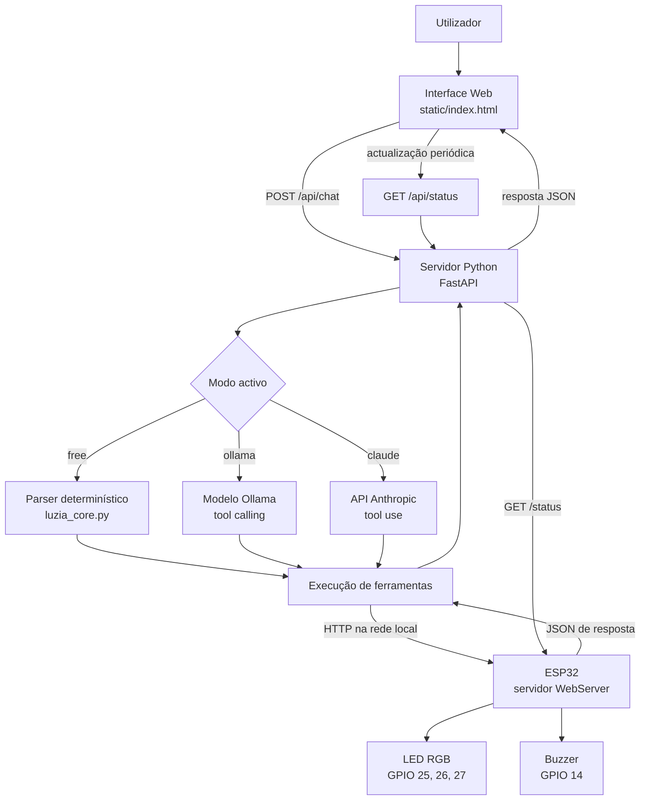
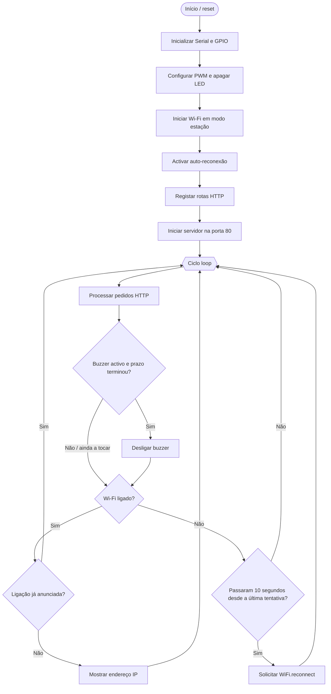
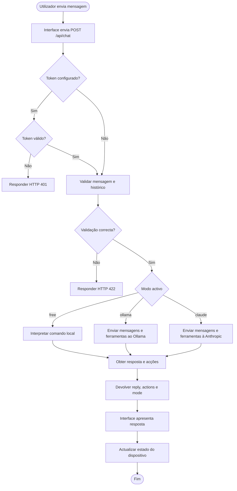
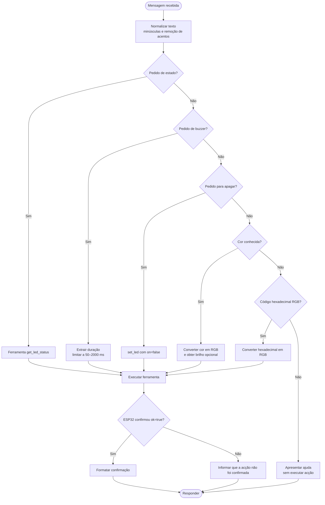
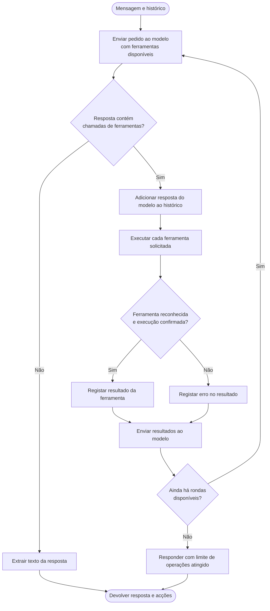
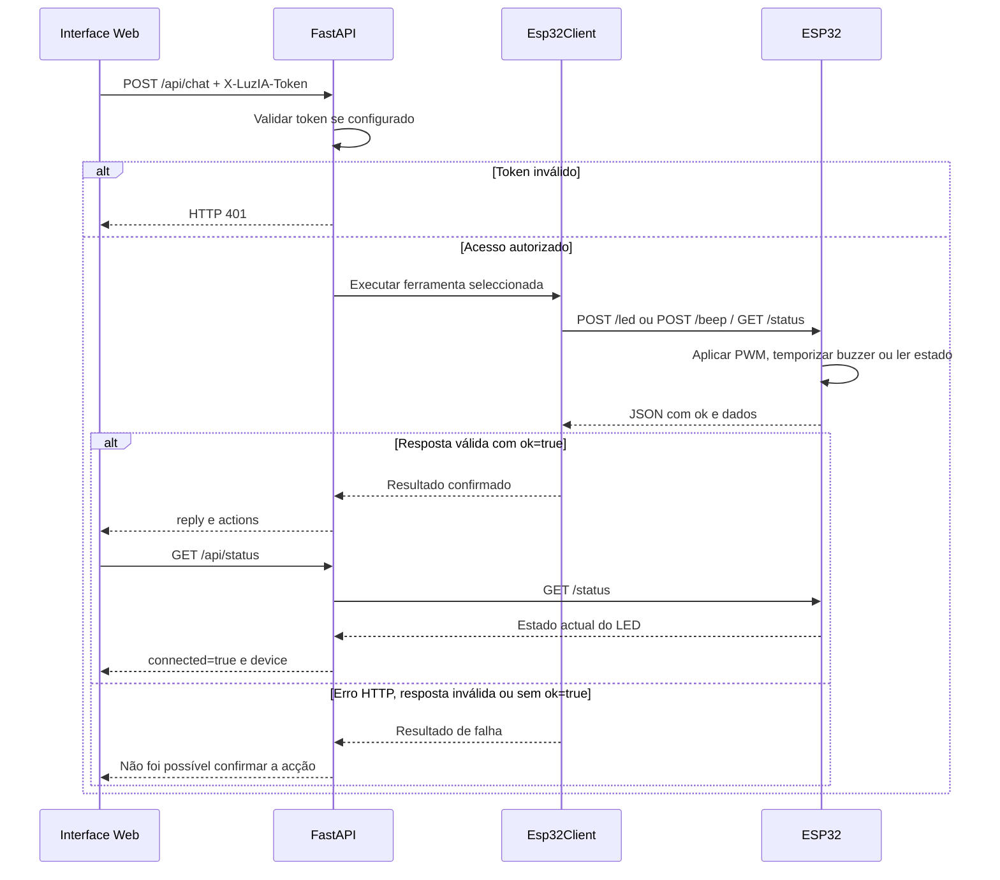
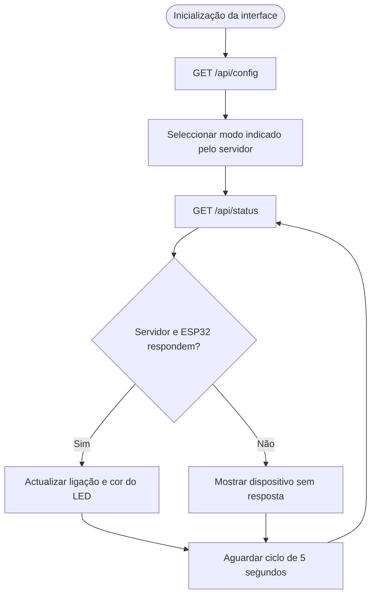
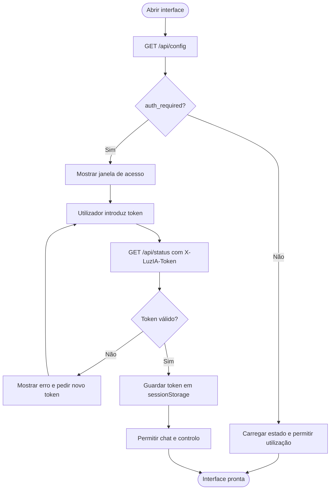

# Fluxogramas da LuzIA

Este documento representa os fluxos observados no código actual do projecto. Não define funcionalidades futuras.

## 1. Arquitectura geral

## 2. Arranque do firmware ESP32

## 3. Recepção e processamento de uma mensagem

## 4. Modo Free — interpretação de comandos

## 5. Modos Ollama e Claude — ciclo de ferramentas

Nota: o servidor limita o ciclo a `MAX_TOOL_ROUNDS + 1` iterações. O formato de chamada de ferramentas difere entre a API Ollama e a API Messages da Anthropic, mas ambas usam as ferramentas definidas pelo servidor.

## 6. Comunicação com o ESP32 e confirmação de acções

## 7. Actualização periódica do estado na interface

## 8. Autenticação opcional da interface

O token é opcional e protege os endpoints de controlo do servidor Python. Não autentica directamente o ESP32 nem cifra o tráfego HTTP.
